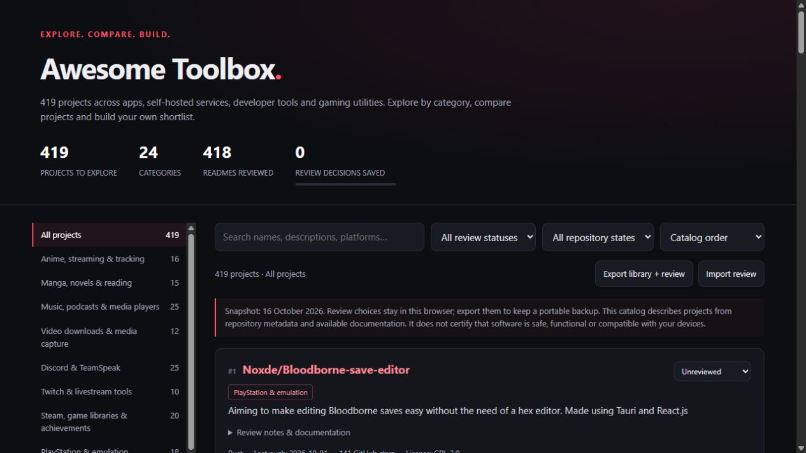

<!-- CAT-COUNTER:START -->

  

<!-- CAT-COUNTER:END -->

# Awesome Toolbox

A categorized collection of apps, self-hosted services, developer tools and gaming utilities, with a searchable black-and-red web catalog.

**[Explore the interactive catalog](https://chunma-san.github.io/awesome-toolbox/)** · [JSON data](catalog.json) · [CSV data](catalog.csv) · [Contribute](CONTRIBUTING.md)

## Features

- 519 projects organized into 71 categories.
- Search descriptions, platforms and languages; filter archived projects and forks.
- Sort by name, last push date or GitHub star count.
- Automatically include owned public projects and filter them with **My public projects**.
- Optional server automation updates a GitHub profile project directory and activity dashboard.
- Save personal review decisions in your browser, with JSON export and import.
- Works as a static website or by opening index.html locally; no account, API key, tracking or external scripts.

## About this collection

<!-- STATS:START -->
Catalog updated: 2026-10-24. 509 entries have available README documentation. Metadata can become outdated.
<!-- STATS:END -->

Inclusion is informational and does not mean endorsement, security review or a successful runtime test.

In the initial collection, the only project without an available README was [SleepyCatHey/Yasb-GlazeWM-Config](https://github.com/SleepyCatHey/Yasb-GlazeWM-Config); its entry is based on repository metadata. Full upstream README copies are not redistributed here.

<!-- CATALOG:START -->

## Contents

- [Anime, streaming & tracking](#anime-streaming--tracking) (17)
- [Manga, novels & reading](#manga-novels--reading) (15)
- [Music, podcasts & media players](#music-podcasts--media-players) (30)
- [Video downloads & media capture](#video-downloads--media-capture) (11)
- [Discord & TeamSpeak](#discord--teamspeak) (31)
- [Twitch & livestream tools](#twitch--livestream-tools) (10)
- [Steam, game libraries & achievements](#steam-game-libraries--achievements) (22)
- [PlayStation & emulation](#playstation--emulation) (31)
- [AION 2 & Where Winds Meet](#aion-2--where-winds-meet) (9)
- [Game mods & automation](#game-mods--automation) (25)
- [Windows maintenance & installation](#windows-maintenance--installation) (24)
- [Desktop, hardware & customization](#desktop-hardware--customization) (23)
- [Android apps & launchers](#android-apps--launchers) (34)
- [Android root, patches & stores](#android-root-patches--stores) (29)
- [Browsers & web extensions](#browsers--web-extensions) (21)
- [Privacy, DNS & security](#privacy-dns--security) (25)
- [Messaging & file sharing](#messaging--file-sharing) (10)
- [Networking, virtualization & remote access](#networking-virtualization--remote-access) (13)
- [Self-hosting, feeds & infrastructure](#self-hosting-feeds--infrastructure) (17)
- [Development, AI & security research](#development-ai--security-research) (14)
- [Creative tools, documents & translation](#creative-tools-documents--translation) (16)
- [Account tools, activation & verification](#account-tools-activation--verification) (12)
- [Curated lists & learning resources](#curated-lists--learning-resources) (19)
- [TV & channel catalogs](#tv--channel-catalogs) (1)
- [GrapheneOS & Android operating systems](#grapheneos--android-operating-systems) (4)
- [GrapheneOS apps & browsers](#grapheneos-apps--browsers) (5)
- [GrapheneOS infrastructure & services](#grapheneos-infrastructure--services) (7)
- [Linux distributions & package managers](#linux-distributions--package-managers) (1)
- [Windows compatibility & Wine](#windows-compatibility--wine) (1)
- [Android app patching & modding](#android-app-patching--modding) (4)
- [Camera, gallery & photo management](#camera-gallery--photo-management) (1)
- [RSS, news & bookmarking](#rss-news--bookmarking) (1)
- [VPN, proxies & tunnels](#vpn-proxies--tunnels) (1)
- [Containers & orchestration](#containers--orchestration) (1)
- [APIs, SDKs & integrations](#apis-sdks--integrations) (1)
- [CLI, terminal & shell tools](#cli-terminal--shell-tools) (1)
- [AI assistants & coding tools](#ai-assistants--coding-tools) (1)
- [GitHub profiles & README tools](#github-profiles--readme-tools) (1)
- [Git, CI & release automation](#git-ci--release-automation) (1)
- [Translation, subtitles & accessibility](#translation-subtitles--accessibility) (1)
- [Torrents, debrid & download managers](#torrents-debrid--download-managers) (1)
- [Media servers & streaming infrastructure](#media-servers--streaming-infrastructure) (1)
- [Browser privacy & ad blocking](#browser-privacy--ad-blocking) (2)
- [Game engines & development](#game-engines--development) (1)
- [Device firmware & embedded systems](#device-firmware--embedded-systems) (1)
- [Other software & utilities](#other-software--utilities) (22)

## Anime, streaming & tracking

- [nyyrox2/Zenkai](https://github.com/nyyrox2/Zenkai) — A self-hostable web app for anime, films, manga and novels, with tracking and an integrated player.
- [Seanime-contributions/Seanime-Providers](https://github.com/Seanime-contributions/Seanime-Providers) — This repository contains custom Seanime extensions for adding support to various manga and anime sources.
- [Bas1874/Seanime-Marketplace](https://github.com/Bas1874/Seanime-Marketplace) — This repository contains custom Seanime extensions created by the community
- [MALSync/MALSync](https://github.com/MALSync/MALSync) — Integrates MyAnimeList/AniList/Kitsu/Simkl into various sites, with auto episode tracking.
- [5rahim/seanime](https://github.com/5rahim/seanime) — Open-source media server with a web interface and desktop app for anime and manga.
- [Spyou/Zangetsu](https://github.com/Spyou/Zangetsu) — Free, open-source app for anime, movies, series, manga and light novels — on Android, Android TV and iOS (beta).
- [Zaarrg/stremio-community-v5](https://github.com/Zaarrg/stremio-community-v5) — 🐚 WebView2 and Qt6-based shell, desktop app for Stremio with latest web ui support
- [RyanYuuki/AnymeX](https://github.com/RyanYuuki/AnymeX) — An Open Source app for Tracking Multi Service (AL, MAL, SIMKL)
- [komikku-app/anikku](https://github.com/komikku-app/anikku) — Free and open source anime watcher for Android
- [JICA98/DailyAL](https://github.com/JICA98/DailyAL) — DailyAL - MyAnimeList Client
- [REVENGE977/stremio-enhanced](https://github.com/REVENGE977/stremio-enhanced) — Electron-based Stremio desktop client with support for plugins and themes. This is a community project and is not affiliated with Stremio in any way.
- [soruly/trace.moe](https://github.com/soruly/trace.moe) — Timestamp Retrieval for Anime Clips Everywhere
- [axiel7/MoeList](https://github.com/axiel7/MoeList) — Another unofficial Android MAL client
- [wotakumoe/wotaku](https://github.com/wotakumoe/wotaku) — An otaku index for everything! ⭐ Star the project if you like it!
- [aniyomiorg/aniyomi](https://github.com/aniyomiorg/aniyomi) — An app for manga and anime
- [axiel7/AniHyou-android](https://github.com/axiel7/AniHyou-android) — Another unofficial Android AniList client
- [cenodude/CrossWatch](https://github.com/cenodude/CrossWatch) — Synchronize your data across media servers, media agents and trackers. Keep your movies and shows in sync, no matter where you watch.

## Manga, novels & reading

- [Kareadita/Kavita](https://github.com/Kareadita/Kavita) — Kavita is a fast, feature rich, cross platform reading server. Built with the goal of being a full solution for all your reading needs. Setup your own server and share your reading collection with your friends and family.
- [Suwayomi/Suwayomi-Server](https://github.com/Suwayomi/Suwayomi-Server) — A rewrite of Tachiyomi for the Desktop
- [syncyomi/syncyomi](https://github.com/syncyomi/syncyomi) — SyncYomi is an open-source project crafted to provide a seamless synchronization experience for your TachiyomiSY/Mihon (Mihon client is not implemented but it works the same probably will never be implemented)/manga reading progress and library across multiple devices.
- [mienaiyami/yomikiru](https://github.com/mienaiyami/yomikiru) — A powerful offline manga, manhwa, comic, and novel reader for desktop  Yomikiru is a feature-rich desktop application designed for reading locally stored manga, comics, webtoons, and EPUB novels. Built with Electron and React, it offers a customizable and distraction-free reading experience.
- [komikku-app/komikku](https://github.com/komikku-app/komikku) — Free and open source manga reader for Android
- [ndiuky/lotm](https://github.com/ndiuky/lotm) — Pathway symbols from the Lord of the Mysteries setting.
- [Bittu5134/LOTM-Reader](https://github.com/Bittu5134/LOTM-Reader) — A community driven webnovel reader built with Svelte, with offline caching and a tons of optimizations.  Built to be faster and cleaner than what was out there. 
- [Limitless-Soul1/Sard](https://github.com/Limitless-Soul1/Sard) — Sard (سَرْد) — a desktop EPUB & PDF reader with first-class Arabic typography. Tauri 2 + Rust + React. Offline neural text-to-speech, spoiler-safe search, references, annotations, 16 themes, full RTL. Your library stays on your machine.
- [LagradOst/QuickNovel](https://github.com/LagradOst/QuickNovel) — Android app for downloading novels
- [IReaderorg/IReader](https://github.com/IReaderorg/IReader) — Free and open source novel reader for Android and Desktop.
- [HDoujinDownloader/HDoujinDownloader](https://github.com/HDoujinDownloader/HDoujinDownloader) — A general-purpose doujinshi and image gallery downloader
- [lnreader/lnreader-plugins](https://github.com/lnreader/lnreader-plugins) — Repository to host plugin related issues, and requests for LNReader
- [lnreader/lnreader](https://github.com/lnreader/lnreader) — Light novel reader for Android.
- [mihonapp/mihon](https://github.com/mihonapp/mihon) — Free and open source manga reader for Android
- [keiyoushi/extensions](https://github.com/keiyoushi/extensions) — Extension repository for Mihon and variants

## Music, podcasts & media players

- [LumePart/Explo](https://github.com/LumePart/Explo) — Spotify's "Discover Weekly" for self-hosted music systems
- [ghenry22/substreamer](https://github.com/ghenry22/substreamer) — Substreamer - Subsonic Music Streamer
- [jeffvli/feishin](https://github.com/jeffvli/feishin) — A modern self-hosted music player.
- [ssalggnikool/Navic](https://github.com/ssalggnikool/Navic) — Subsonic music streaming app for Android
- [beetbox/beets](https://github.com/beetbox/beets) — music library manager and MusicBrainz tagger
- [navidrome/navidrome](https://github.com/navidrome/navidrome) — 🎧 Your Personal Streaming Service 
- [spotiflacapp/SpotiFLAC-Mobile](https://github.com/spotiflacapp/SpotiFLAC-Mobile) — Mobile music utility built with Flutter and Go. High-quality audio management for your personal library. - open source, no ads, no subscription.
- [crmne/spotifast](https://github.com/crmne/spotifast) — Spotify, native and fast. One lightweight Rust app for your whole library, local playback, and Spotify Connect on Linux, macOS, and Windows.
- [Riteshp2001/mpvRx](https://github.com/Riteshp2001/mpvRx) — The most Powerful, Efficient + Feature-packed media player fork you’ll find anywhere.
- [Samillion/ModernZ](https://github.com/Samillion/ModernZ) — A sleek and modern OSC for mpv. This project is a fork of ModernX that enhances functionality by adding more features while preserving the core standards of mpv's OSC.
- [shinchiro/mpv-winbuild-cmake](https://github.com/shinchiro/mpv-winbuild-cmake) —  CMake-based MinGW-w64 Cross Toolchain 
- [mpv-player/mpv](https://github.com/mpv-player/mpv) — 🎥 Command line media player
- [SaifAqqad/AHK_MicMute](https://github.com/SaifAqqad/AHK_MicMute) — Super simple mic control with all the tweaks you could ever want
- [AntennaPod/AntennaPod](https://github.com/AntennaPod/AntennaPod) — A podcast manager for Android
- [MetrolistGroup/Metrolist](https://github.com/MetrolistGroup/Metrolist) — YouTube Music client for Android
- [maxrave-dev/SimpMusic](https://github.com/maxrave-dev/SimpMusic) — A cross-platform music app using YouTube Music for backend
- [spicetify/cli](https://github.com/spicetify/cli) — Command-line tool to customize Spotify client. Supports Windows, macOS, and Linux.
- [AudileTeam/Audile](https://github.com/AudileTeam/Audile) — An open-source Android app for music recognition that integrates AudD, ACRCloud, and Shazam to perform song identification.
- [team-spotube/spotube](https://github.com/team-spotube/spotube) — 🎧 Open source music streaming app! Available for both desktop & mobile!
- [OxygenCobalt/Auxio](https://github.com/OxygenCobalt/Auxio) — A simple, rational music player for android
- [gokadzev/Musify](https://github.com/gokadzev/Musify) — Unlock the full potential of music: Stream effortlessly with one app!
- [Lambada10/SongSync](https://github.com/Lambada10/SongSync) — Android app to download lyrics for songs in your music library.
- [pear-devs/pear-desktop](https://github.com/pear-devs/pear-desktop) — Pear 🍐 is extension for music player
- [SpotX-Official/SpotX](https://github.com/SpotX-Official/SpotX) — SpotX patcher used for patching the desktop version of Spotify
- [spotDL/spotify-downloader](https://github.com/spotDL/spotify-downloader) — Download your Spotify playlists and songs along with album art and metadata (from YouTube if a match is found).
- [chunma-san/music-downloader](https://github.com/chunma-san/music-downloader) — A URL-based music download helper with optional owner-restricted Telegram controls.
- [chunma-san/music-metadata](https://github.com/chunma-san/music-metadata) — Music metadata matching and batch confidence reports for local audio collections.
- [chunma-san/telegram-music](https://github.com/chunma-san/telegram-music) — A configurable Telegram audio saver with persistent processing history and local session storage.
- [ytmdesktop/ytmdesktop](https://github.com/ytmdesktop/ytmdesktop) — A Desktop App for YouTube Music
- [rukamori/ArchiveTune](https://github.com/rukamori/ArchiveTune) — 🌸 The Cutest Music Player With Support Local File and Youtube Music for Android!

## Video downloads & media capture

- [mediago-dev/mediago](https://github.com/mediago-dev/mediago) — Cross-platform video downloader — sniff and grab m3u8/HLS streams, Bilibili, YouTube and more. Desktop + Docker + 🦞.
- [the1812/Bilibili-Evolved](https://github.com/the1812/Bilibili-Evolved) — A browser userscript that extends and customizes the Bilibili website.
- [instaloader/instaloader](https://github.com/instaloader/instaloader) — Download pictures (or videos) along with their captions and other metadata from Instagram.
- [imputnet/cobalt](https://github.com/imputnet/cobalt) — best way to save what you love
- [soimort/you-get](https://github.com/soimort/you-get) — :arrow_double_down: Dumb downloader that scrapes the web
- [alexta69/metube](https://github.com/alexta69/metube) — Self-hosted video downloader for YouTube and other sites (web UI for yt-dlp)
- [nexmoe/VidBee](https://github.com/nexmoe/VidBee) — Download video and audio from  YouTube ,  TikTok ,  Twitter ,  Instagram ,  Facebook ,  Twitch ,  Bilibili , and 1000+ sites—or import local media. Create searchable transcripts on your computer, then summarize, translate, or ask questions with your preferred AI provider.
- [Tyrrrz/YoutubeDownloader](https://github.com/Tyrrrz/YoutubeDownloader) — Downloads videos and playlists from YouTube
- [aandrew-me/ytDownloader](https://github.com/aandrew-me/ytDownloader) — Desktop app to download audio/video from hundreds of sites
- [jarvis2f/telegram-files](https://github.com/jarvis2f/telegram-files) — A self-hosted Telegram file downloader for continuous, stable, and unattended downloads.
- [deniscerri/ytdlnis](https://github.com/deniscerri/ytdlnis) — Full-featured audio/video downloader for Android using yt-dlp

## Discord & TeamSpeak

- [open-discord-bots/plugins](https://github.com/open-discord-bots/plugins) — The official list of plugins for Open Ticket & Open Discord related projects!
- [open-discord-bots/open-ticket](https://github.com/open-discord-bots/open-ticket) — The most advanced self-hosted discord ticket bot with transcripts, plugins, questions, claiming, statistics, pterodactyl/docker support & more!
- [nyxxbit/discord-quest-completer](https://github.com/nyxxbit/discord-quest-completer) — Completes Discord Quests without playing them. All five types, including achievement-in-activity, which is the reason it exists. Userscript or Vencord plugin, same engine. Discord has been enforcing against quest automation since April 2026, read the warning in the README before running it.
- [riolubruh/YABDP4Nitro](https://github.com/riolubruh/YABDP4Nitro) — Yet Another BetterDiscord Plugin for Nitro features. Unlock screensharing modes, use cross-server and gif emotes and much more!
- [OpenAsar/arrpc](https://github.com/OpenAsar/arrpc) — Open Discord RPC server for atypical setups
- [ItsDenji777/SteamWidgetUpdater](https://github.com/ItsDenji777/SteamWidgetUpdater) — A scheduled GitHub Actions workflow that fetches Steam statistics and updates a Discord profile widget.
- [Splamy/TS3AudioBot](https://github.com/Splamy/TS3AudioBot) — Advanced Musicbot for Teamspeak 3
- [GooseMod/OpenAsar](https://github.com/GooseMod/OpenAsar) — Open-source alternative of Discord desktop's app.asar
- [ImHisako/Illegalcord](https://github.com/ImHisako/Illegalcord) — The other cutest Discord client mod but more illegal 
- [PalmDevs/jasper-bot](https://github.com/PalmDevs/jasper-bot) — 🦝 Providing Discord assistance as well as occasional yelling. Jasper is self-hostable general-purpose Discord bot that yells at you and your members.
- [Just-Some-Bots/MusicBot](https://github.com/Just-Some-Bots/MusicBot) — :musical_note: The original MusicBot for Discord (formerly SexualRhinoceros/MusicBot)
- [konzz/discord-dkp-bot](https://github.com/konzz/discord-dkp-bot) — A Discord guild bot for raid points, attendance, character registration and DKP history.
- [codebymitch/TitanBot](https://github.com/codebymitch/TitanBot) — A powerful, all-in-one Discord assistant built for every server. 
- [viciouscal/Vencord](https://github.com/viciouscal/Vencord) — The cutest Discord client mod
- [darkkpy/overload](https://github.com/darkkpy/overload) — Spam with multiple accounts in discord
- [mudachyo/Discord-The-Last-Meadow](https://github.com/mudachyo/Discord-The-Last-Meadow) — Discord The Last Meadow Autoclicker | Автокликер
- [FxEmbed/FxEmbed](https://github.com/FxEmbed/FxEmbed) — Fix X/Twitter and Bluesky embeds! Use multiple images, videos, polls, translations and more on Discord, Telegram and others
- [Legcord/Legcord](https://github.com/Legcord/Legcord) — Legcord is a custom client designed to enhance your Discord experience while keeping everything lightweight.
- [nin0-dev/VendroidEnhanced](https://github.com/nin0-dev/VendroidEnhanced) — VendroidEnhanced is a fork of Vendroid, a custom client for Discord that loads the mobile website and injects Vencord, the cutest client mod.
- [revenge-mod/revenge-manager](https://github.com/revenge-mod/revenge-manager) — 🤖 Application to use Revenge on Android
- [Aliucord/Manager](https://github.com/Aliucord/Manager) — The new way to install Aliucord – in a user-friendly way
- [victornpb/undiscord](https://github.com/victornpb/undiscord) — Undiscord - Delete all messages in a Discord server / channel or DM (Easy and fast) Bulk delete
- [SpikeHD/Dorion](https://github.com/SpikeHD/Dorion) — Tiny alternative Discord client with a smaller footprint, snappier startup, themes, plugins and more!
- [Equicord/Equicord](https://github.com/Equicord/Equicord) — The other cutest Discord client mod
- [Vendicated/Vencord](https://github.com/Vendicated/Vencord) — The cutest Discord modification
- [chunma-san/discord-archive](https://github.com/chunma-san/discord-archive) — A modular Discord event archive with audit logs, moderation records and voice dashboards.
- [chunma-san/discord-voice-keeper](https://github.com/chunma-san/discord-voice-keeper) — A silent Discord voice bot with a saved channel and automatic connection maintenance.
- [chunma-san/teamspeak-control](https://github.com/chunma-san/teamspeak-control) — Discord controls for configured TeamSpeak audio-bot containers and an announcement timer.
- [chunma-san/teamspeak-timer](https://github.com/chunma-san/teamspeak-timer) — Configurable TeamSpeak announcements through TS3AudioBot APIs with local timer control.
- [Tyrrrz/DiscordChatExporter](https://github.com/Tyrrrz/DiscordChatExporter) — Saves Discord chat logs to a file
- [chunma-san/Equicord](https://github.com/chunma-san/Equicord) — The other cutest Discord client mod

## Twitch & livestream tools

- [rangermix/TwitchDropsMiner](https://github.com/rangermix/TwitchDropsMiner) — An app that allows you to AFK mine timed Twitch drops, with automatic drop claiming and channel switching. Web GUI, dockerised.
- [SimpliAj/twitchdropsminer](https://github.com/SimpliAj/twitchdropsminer) — An app that allows you to AFK mine timed Twitch drops, with automatic drop claiming and channel switching. Web GUI, dockerised.
- [Guliveer/twitch-miner-go](https://github.com/Guliveer/twitch-miner-go) — A fast, lightweight Twitch automation bot written in Go. Automatically claims channel points, Twitch Drops, bonuses, predictions, raids, and more. Multi-account, Docker, PostgreSQL and notifications supported.
- [ryanbr/TwitchAdSolutions](https://github.com/ryanbr/TwitchAdSolutions) — Community scripts and guidance for reducing ads in Twitch playback.
- [Enmn/KickNoSub](https://github.com/Enmn/KickNoSub) — Extract direct stream URLs from Kick videos in your preferred quality for educational and research purposes.
- [younesaassila/ttv-lol-pro](https://github.com/younesaassila/ttv-lol-pro) — TTV LOL PRO removes most livestream ads from Twitch.
- [DevilXD/TwitchDropsMiner](https://github.com/DevilXD/TwitchDropsMiner) — An app that allows you to AFK mine timed Twitch drops, with automatic drop claiming and channel switching.
- [besuper/TwitchNoSub](https://github.com/besuper/TwitchNoSub) — An extension to watch sub only VOD on Twitch
- [pixeltris/TwitchAdSolutions](https://github.com/pixeltris/TwitchAdSolutions) — Archived collection of Twitch ad-blocking scripts and playback workarounds.
- [crackededed/Xtra](https://github.com/crackededed/Xtra) — Third-party Twitch client for Android

## Steam, game libraries & achievements

- [Shirowwww/Achievement-Watcher-Next](https://github.com/Shirowwww/Achievement-Watcher-Next) — Achievement Watcher Next: a free achievement tracker for Windows and Linux. Achievements, rarity and playtime from Steam, GOG, Epic, Ubisoft, EA, Xbox, emulators and Wine or Proton games, with popups and an in-game overlay.
- [BeyondDimension/SteamTools](https://github.com/BeyondDimension/SteamTools) — Watt Toolkit: a cross-platform collection of Steam and gaming utilities.
- [SteamGridDB/steam-rom-manager](https://github.com/SteamGridDB/steam-rom-manager) — The bulk game importer and artwork manager for Steam! 
- [legendary-gl/legendary](https://github.com/legendary-gl/legendary) — Legendary - A free and open-source replacement for the Epic Games Launcher
- [madoiscool/LuaTools](https://github.com/madoiscool/LuaTools) — AppID Manager for ST
- [mtkennerly/ludusavi](https://github.com/mtkennerly/ludusavi) — Backup tool for PC game saves
- [Midrags/SFF](https://github.com/Midrags/SFF) — SteaMidra - Advanced Steam game setup and management tool featuring manifest handling, Lua integrations, LumaCore deployment, multiplayer fixes, DLC unlocking, backups, game fixes, and an easy-to-use GUI. Educational purposes only.
- [PSerban93/Achievements](https://github.com/PSerban93/Achievements) — A desktop application built with Electron that monitors running games and displays achievements animated notifications
- [atom0s/Steamless](https://github.com/atom0s/Steamless) — Steamless is a DRM remover of the SteamStub variants.  The goal of Steamless is to make a single solution for unpacking all Steam DRM-packed files. Steamless aims to support as many games as possible. 
- [SteamRE/DepotDownloader](https://github.com/SteamRE/DepotDownloader) — Steam depot downloader utilizing the SteamKit2 library.
- [OpenCloudGaming/OpenNOW](https://github.com/OpenCloudGaming/OpenNOW) — Custom GeForce Now Client Named OpenNOW
- [zevnda/steam-game-idler](https://github.com/zevnda/steam-game-idler) — Farm Steam trading cards, manage achievements, and idle games automatically — an all-in-one alternative to ArchiSteamFarm, Steam Achievement Manager, and Idle Master
- [Fumo-Unlockers/Xbox-Achievement-Unlocker](https://github.com/Fumo-Unlockers/Xbox-Achievement-Unlocker) — Achievement unlocker for xbox games (barely works but it does)
- [vogler/free-games-claimer](https://github.com/vogler/free-games-claimer) — Automatically claims free games and DLCs on the Epic Games Store, Amazon Prime Gaming and GOG.
- [JustArchiNET/ArchiSteamFarm](https://github.com/JustArchiNET/ArchiSteamFarm) — C# application with primary purpose of farming Steam cards from multiple accounts simultaneously.
- [skydevil88/XboxDownload](https://github.com/skydevil88/XboxDownload) — A download-assistance utility covering Xbox, Microsoft Store and several game distribution platforms.
- [hydralauncher/hydra](https://github.com/hydralauncher/hydra) — Hydra Launcher is an open-source gaming platform created to be the single tool that you need
- [k1tbyte/Wand-Enhancer](https://github.com/k1tbyte/Wand-Enhancer) — An extension that adds interface and interoperability features to Wand / WeMod.
- [gibbed/SteamAchievementManager](https://github.com/gibbed/SteamAchievementManager) — A manager for game achievements in Steam.
- [SteamClientHomebrew/Millennium](https://github.com/SteamClientHomebrew/Millennium) — An open-source framework for Steam Client themes and plugins
- [Citrinate/FreePackages](https://github.com/Citrinate/FreePackages) — An ASF plugin for finding and redeeming free Steam games
- [chunma-san/steam-idle-monitor](https://github.com/chunma-san/steam-idle-monitor) — Idle and farming interval estimates from ArchiSteamFarm Docker logs.

## PlayStation & emulation

- [Noxde/Bloodborne-save-editor](https://github.com/Noxde/Bloodborne-save-editor) — Aiming to make editing Bloodborne saves easy without the need of a hex editor. Made using Tauri and React.js
- [Supermedo/uncharted_pc](https://github.com/Supermedo/uncharted_pc) — Uncharted: The Nathan Drake Collection running natively on Windows - by SuperMedo
- [AzaharPlus/shadPS4Plus](https://github.com/AzaharPlus/shadPS4Plus) — Standalone PKG extractor based on code that used to be in ShadPS4
- [Supermedo/bloodborne_pc](https://github.com/Supermedo/bloodborne_pc) — Bloodborne running natively on Windows 10/11: launcher in 13 languages, DLSS, FSR 3.1/4, unlocked FPS, cheats, mods, one-click updates.
- [Classmg22/BBSC](https://github.com/Classmg22/BBSC) — Bloodborne Seamless Co-op: a shadPS4 mod that keeps co-op alive through deaths, lamps, areas, bosses and the Hunter's Dream - up to 5 hunters.
- [D3ATHLY/blackbox](https://github.com/D3ATHLY/blackbox) — A PS5 homebrew storefront and download manager; its catalog contains metadata and external content links.
- [overdriveps5/overdrive-releases](https://github.com/overdriveps5/overdrive-releases) — Overdrive releases for jailbroken PS5
- [FelipePrado0/gow3_pc](https://github.com/FelipePrado0/gow3_pc) — God of War III Remastered (PS4) for Windows and Linux (experimental AppImage). Original x86-64 code runs directly on the CPU with a custom runtime; graphics use shadPS4's Vulkan video core and cuesta4's fixes. Launcher, in-game menu, controller icons and up to 240 FPS. Requires your own game dump. No game files included.
- [itsPLK/ps5-webkit-autoloader](https://github.com/itsPLK/ps5-webkit-autoloader) — An automated payload loader for already exploited PS5 consoles.
- [ntfargo/Relapse-Exploit](https://github.com/ntfargo/Relapse-Exploit) — A PS5 exploit-chain research project with firmware-specific requirements.
- [boykopovar/AnyPS5](https://github.com/boykopovar/AnyPS5) — Tool for automatic PS5 executables porting to Linux and Windows
- [sharpemu/sharpemu](https://github.com/sharpemu/sharpemu) — An experimental PlayStation 5 emulator for Windows, Linux and macOS.
- [KytyPS5/KytyPS5](https://github.com/KytyPS5/KytyPS5) — PlayStation 5 translation layer for Windows, Linux and macOS
- [Swordfish90/Lemuroid](https://github.com/Swordfish90/Lemuroid) — All in one emulator on Android!
- [RainbowCookie32/rusty-psn](https://github.com/RainbowCookie32/rusty-psn) — A GUI/CLI tool for downloading PS3, PS4, and PSVita game updates
- [NookieAI/PS4-Vault](https://github.com/NookieAI/PS4-Vault) — Electron app to scan, organize, and wirelessly install PS4 PKG game files to a jailbroken console via GoldHEN/etaHEN (Windows, macOS, Linux)
- [Gezine/Y2JB](https://github.com/Gezine/Y2JB) — A PS5 userland code-execution research project involving the YouTube application.
- [DrYenyen/PPPwn-Tinker-GUI](https://github.com/DrYenyen/PPPwn-Tinker-GUI) — PPPwn Tinker GUI
- [Swordpdf/PS5SX2](https://github.com/Swordpdf/PS5SX2) — A port of PCSX2 for PS5
- [darlinghq/darling](https://github.com/darlinghq/darling) — Darwin/macOS emulation layer for Linux
- [LoreanXavier/pt-pc](https://github.com/LoreanXavier/pt-pc) — Native PC port of P.T. (runs from your own PS4 game files)
- [stenzek/duckstation](https://github.com/stenzek/duckstation) — Fast PlayStation 1 emulator for x86-64/AArch32/AArch64/RV64
- [xemu-project/xemu](https://github.com/xemu-project/xemu) — Original Xbox Emulator for Windows, macOS, and Linux (Active Development)
- [Vita3K/Vita3K](https://github.com/Vita3K/Vita3K) — Experimental PlayStation Vita emulator
- [RetroPie/RetroPie-Setup](https://github.com/RetroPie/RetroPie-Setup) — Shell script to set up a Raspberry Pi/Odroid/PC with RetroArch emulator and various cores
- [cemu-project/Cemu](https://github.com/cemu-project/Cemu) — Cemu - Wii U emulator
- [xenia-project/xenia](https://github.com/xenia-project/xenia) — Xbox 360 Emulator Research Project
- [dolphin-emu/dolphin](https://github.com/dolphin-emu/dolphin) — Dolphin is a GameCube / Wii emulator, allowing you to play games for these two platforms on PC with improvements.
- [RPCS3/rpcs3](https://github.com/RPCS3/rpcs3) — PlayStation 3 emulator and debugger
- [shadps4-emu/shadPS4](https://github.com/shadps4-emu/shadPS4) — PlayStation 4 emulator for Windows, Linux, macOS and FreeBSD written in C++
- [PCSX2/pcsx2](https://github.com/PCSX2/pcsx2) — PCSX2 - The Playstation 2 Emulator

## AION 2 & Where Winds Meet

- [cloris-chan/Aion2Flow](https://github.com/cloris-chan/Aion2Flow) — Aion2Flow is a real-time combat analysis tool for AION 2.
- [KaiiZzeR971/AION-2-Discord-Rich-Presence](https://github.com/KaiiZzeR971/AION-2-Discord-Rich-Presence) — AION 2 Discord Rich Presence for Windows 10/11 | Global, TW & KR | Automatic game detection, class icons, FR/EN
- [Iota-Nine/Aion2-Eclipse](https://github.com/Iota-Nine/Aion2-Eclipse) — Eclipse — free AION 2 DPS meter for Windows. Live party overlay, Glass client, saved dungeon runs, skill analysis, healing/HPS and shield application counts, build comparisons, Rift timers, English/French and direct .exe setup.
- [taengu/A2Tools-DPS-Meter](https://github.com/taengu/A2Tools-DPS-Meter) — A DPS meter for AION2 that works for any region, providing analysis of fights.
- [problem-xyz/aion2-map-overlay](https://github.com/problem-xyz/aion2-map-overlay) — Aion 2 - Map Overlay, a free route overlay for the Aion 2 map (Windows)
- [Kuroukihime/AIon2-Dps-Meter](https://github.com/Kuroukihime/AIon2-Dps-Meter) — RATmeter - A lightweight, network-based AION 2 DPS meter for global servers
- [SnowiyQ/Where-Winds-Meet-Midi-Player](https://github.com/SnowiyQ/Where-Winds-Meet-Midi-Player) — Modern MIDI Player for Where Winds Meet, supports all keyboard layouts with tons of powerful features.
- [Acedia0/WhereWindsMeet-Lua-Injector](https://github.com/Acedia0/WhereWindsMeet-Lua-Injector) — Proof-of-concept Lua script injector for Where Winds Meet using a dinput8 proxy DLL and Frida Gadget to hook the game’s internal lua_load / lua_pcall and open debug / GM features.
- [chunma-san/discord-community](https://github.com/chunma-san/discord-community) — A configurable AION 2 Discord community bot with guild areas, events, roles and character profiles.

## Game mods & automation

- [PrathxmOp/Prathxm-Patches](https://github.com/PrathxmOp/Prathxm-Patches) — Custom Patches for Chess.com with offline Stockfish 16.1 integration, puzzle system, and local analysis tools for learning chess
- [Lani27/lord-of-mysteries-english-patch](https://github.com/Lani27/lord-of-mysteries-english-patch) — English patch releases for the Lord of Mysteries game.
- [YimMenu/YimMenuV2](https://github.com/YimMenu/YimMenuV2) — Experimental menu for GTA 5: Enhanced
- [Jek47/BO4-GSC-Mods](https://github.com/Jek47/BO4-GSC-Mods) — A repository for pre-compiled BO4 GSC mods for both PC and PS4.
- [Dss0/t7-server-config](https://github.com/Dss0/t7-server-config) — Config for T7 Dedicated Servers for use with the BOIII² Client
- [game1024/OpenSpeedy](https://github.com/game1024/OpenSpeedy) — 🎮 An open-source game speed modifier.
- [Scroptss/T7Patch](https://github.com/Scroptss/T7Patch) — shiversoftdev's t7patch, updated to work with the Feb 2026 and Sep 2026 game updates.
- [Blur009/Blur-AutoClicker](https://github.com/Blur009/Blur-AutoClicker) — An Auto-clicker with a few advanced features and generally better performance than popular alternatives. Made for windows.
- [Sid-1996/BrownDust2-Beat-Helper](https://github.com/Sid-1996/BrownDust2-Beat-Helper) — AutoHotkey v2 tool for Brown Dust 2 music mini-game automation. Features draggable & resizable overlays, color detection, multi-zone support, and INI settings. Perfect for keeping perfect beats without finger fatigue.
- [Jelosus2/BD2-L2D-Viewer](https://github.com/Jelosus2/BD2-L2D-Viewer) — Web-based interactive Live2D and Spine animation viewer for the Brown Dust 2 game.
- [bruhnn/BD2ModManager](https://github.com/bruhnn/BD2ModManager) — Brown Dust 2 Mod Manager to help you manage mods.
- [yemoyu123/Bd2_Client](https://github.com/yemoyu123/Bd2_Client) — 🎮 Latest game client for the BD2 private server.
- [LmeSzinc/AzurLaneAutoScript](https://github.com/LmeSzinc/AzurLaneAutoScript) — An automation framework for routine Azur Lane activities across supported regions.
- [AlteriaX/WuWa-Configs](https://github.com/AlteriaX/WuWa-Configs) — WuWa configs to improve visuals or performance
- [overflow65537/MAA_SnowBreak](https://github.com/overflow65537/MAA_SnowBreak) — An automation assistant for routine Snowbreak: Containment Zone activities.
- [SpectrumQT/XXMI-Launcher](https://github.com/SpectrumQT/XXMI-Launcher) — Modding platform for GI, HSR, WW and ZZZ
- [AuroraDoesCode/ColdWar-Lucy-Base](https://github.com/AuroraDoesCode/ColdWar-Lucy-Base) — a GSC Mod Menu base for Black ops Cold War, Based on the same base on Black ops 4.
- [AuroraDoesCode/BO4-Lucy-Menu](https://github.com/AuroraDoesCode/BO4-Lucy-Menu) — The Lucy Menu - A GSC Mod Menu for Black Ops 4 PC / PS
- [faroukbmiled/BOIIIWD](https://github.com/faroukbmiled/BOIIIWD) — Black Ops 3 GUI Workshop downloader 
- [Scroptss/Scropts-QOL](https://github.com/Scroptss/Scropts-QOL) — Quality-of-life modifications and scripts for Black Ops III.
- [Ezz-lol/boiii-free](https://github.com/Ezz-lol/boiii-free) — A community Black Ops III client project; review its README for current scope and server requirements.
- [shiversoftdev/t7patch](https://github.com/shiversoftdev/t7patch) — A new and improved community patch for BO3. 
- [ate47/atian-cod-tools](https://github.com/ate47/atian-cod-tools) — A collection of Call of Duty research, inspection and modding utilities.
- [jokeri2222/KaHack](https://github.com/jokeri2222/KaHack) — A Kahoot hack made in vanilla js. Just copy-paste to console and you are ready to cheat. Also downloadable to Tampermonkey.
- [ok-oldking/ok-wuthering-waves](https://github.com/ok-oldking/ok-wuthering-waves) — Image-recognition automation for repetitive Wuthering Waves activities on Windows.

## Windows maintenance & installation

- [memstechtips/Winhance](https://github.com/memstechtips/Winhance) — Application designed to optimize, customize and enhance your Windows experience.
- [Turtlecute33/Privacy.sexy-Revamped](https://github.com/Turtlecute33/Privacy.sexy-Revamped) — A maintained fork of a script builder for operating-system privacy, hardening and debloating.
- [Greedeks/GTweak](https://github.com/Greedeks/GTweak) — Portable Tool for an Ideal Windows Setup
- [AdventDevInc/kudu](https://github.com/AdventDevInc/kudu) — Free Windows, Mac and Linux cleaner, scanner, and more.
- [itsfatduck/optimizerDuck](https://github.com/itsfatduck/optimizerDuck) — Free, open-source Windows optimization tool for performance, privacy, and simplicity.
- [Foulest/RepairKit](https://github.com/Foulest/RepairKit) — All-in-one Java-based Windows repair and maintenance toolkit.
- [bleachbit/bleachbit](https://github.com/bleachbit/bleachbit) — BleachBit system cleaner for Windows and Linux
- [BCUninstaller/Bulk-Crap-Uninstaller](https://github.com/BCUninstaller/Bulk-Crap-Uninstaller) — Remove large amounts of unwanted applications quickly.
- [unchihugo/FluentFlyout](https://github.com/unchihugo/FluentFlyout) — The modern Flyout app for Windows 11, built with Fluent 2 Design principles. Media Flyouts, Taskbar Widgets and more.
- [tw93/Mole](https://github.com/tw93/Mole) — 🐹 Keep your Mac and PC clean, light, and running like new. Fast open-source CLI, plus native Mac and Windows apps.
- [nadeoki/win10enterpriseguide](https://github.com/nadeoki/win10enterpriseguide) — a quick guide to Install Windows 10 Enterprise LTSC on a Boot Drive
- [rayenghanmi/RyTuneX](https://github.com/rayenghanmi/RyTuneX) — RyTuneX is a cutting-edge optimizer built with the WinUI 3 framework, designed to amplify the performance of Windows devices. Crafted for both Windows 10 and 11.
- [zoicware/RemoveWindowsAI](https://github.com/zoicware/RemoveWindowsAI) — Force Remove Copilot, Recall and More in Windows 11
- [ionuttbara/windows-defender-remover](https://github.com/ionuttbara/windows-defender-remover) — A tool which is uses to remove Windows Defender in Windows 8.x, Windows 10 (every version) and Windows 11.
- [IgorMundstein/WinMemoryCleaner](https://github.com/IgorMundstein/WinMemoryCleaner) — This free RAM cleaner uses native Windows features to optimize memory areas. It's a compact, portable, and smart application.
- [undergroundwires/privacy.sexy](https://github.com/undergroundwires/privacy.sexy) — Open-source tool to enforce privacy & security best-practices on Windows, macOS and Linux, because privacy is sexy
- [flick9000/winscript](https://github.com/flick9000/winscript) — Open-source tool to build your Windows script from scratch. It includes debloat, privacy, performance & app installing scripts.
- [Sophia-Community/SophiApp](https://github.com/Sophia-Community/SophiApp) — :zap: The most powerful open source tweaker on GitHub for fine-tuning Windows 10 & Windows 11
- [Sycnex/Windows10Debloater](https://github.com/Sycnex/Windows10Debloater) — Script to remove Windows 10 bloatware.
- [farag2/Sophia-Script-for-Windows](https://github.com/farag2/Sophia-Script-for-Windows) — :zap: The most powerful PowerShell module for fine-tuning Windows 10 & Windows 11 on GitHub
- [Raphire/Win11Debloat](https://github.com/Raphire/Win11Debloat) — A simple, lightweight PowerShell script that allows you to remove pre-installed apps, disable telemetry, as well as perform various other changes to declutter and customize your Windows experience. Win11Debloat works for both Windows 10 and Windows 11.
- [qarmin/czkawka](https://github.com/qarmin/czkawka) — Multi functional app to find duplicates, empty folders, similar images etc.
- [memstechtips/UnattendedWinstall](https://github.com/memstechtips/UnattendedWinstall) — Personalized Unattended Answer Files that helps automatically debloat and customize Windows 10 & 11 during the installation process.
- [ChrisTitusTech/winutil](https://github.com/ChrisTitusTech/winutil) — Chris Titus Tech's Windows Utility - Install Programs, Tweaks, Fixes, and Updates

## Desktop, hardware & customization

- [BlueHeisenberg/SCSKiller](https://github.com/BlueHeisenberg/SCSKiller) — Kill shader compilation stutter before you play. Compiles your games' shaders into the GPU driver's cache ahead of time. Windows, NVIDIA and AMD.
- [Flow-Launcher/Flow.Launcher](https://github.com/Flow-Launcher/Flow.Launcher) — :mag: Quick file search & app launcher for Windows with community-made plugins
- [qmk/qmk_firmware](https://github.com/qmk/qmk_firmware) — Open-source firmware for custom mechanical keyboards and supported microcontrollers.
- [Orbmu2k/nvidiaProfileInspector](https://github.com/Orbmu2k/nvidiaProfileInspector) — A Windows editor for NVIDIA driver profiles, hidden settings and per-game overrides.
- [iandiv/AppGroup](https://github.com/iandiv/AppGroup) — App Group lets you organize, customize, and launch your apps.
- [keylase/nvidia-patch](https://github.com/keylase/nvidia-patch) —  This patch removes restriction on maximum number of simultaneous NVENC video encoding sessions imposed by Nvidia to consumer-grade GPUs.
- [ilyamiro/serpantinum](https://github.com/ilyamiro/serpantinum) — A shell for wayland compositors
- [glzr-io/glazewm](https://github.com/glzr-io/glazewm) — GlazeWM is a tiling window manager for macOS and Windows inspired by i3wm.
- [AvengeMedia/DankMaterialShell](https://github.com/AvengeMedia/DankMaterialShell) — Desktop shell for wayland compositors built with Quickshell & GO, optimized for niri, hyprland, sway, MangoWC, labwc, and MiracleWM.
- [CalcProgrammer1/OpenRGB](https://github.com/CalcProgrammer1/OpenRGB) — Open source RGB lighting control that doesn't depend on manufacturer software. Supports Windows, Linux, MacOS.  Mirror of https://gitlab.com/CalcProgrammer1/OpenRGB.  Releases can be found on GitLab.
- [win12-online/win12](https://github.com/win12-online/win12) — A browser-based desktop interface inspired by a Windows-style operating system.
- [SleepyCatHey/Yasb-GlazeWM-Config](https://github.com/SleepyCatHey/Yasb-GlazeWM-Config) — A saved configuration repository for the YASB status bar and GlazeWM. No README was available.
- [amnweb/yasb](https://github.com/amnweb/yasb) — A highly configurable Windows status bar written in Python. 
- [winsiderss/systeminformer](https://github.com/winsiderss/systeminformer) — A free, powerful, multi-purpose tool that helps you monitor system resources, debug software and detect malware. Brought to you by Winsider Seminars & Solutions, Inc. @ https://windows-internals.com
- [files-community/Files](https://github.com/files-community/Files) — A modern file manager that helps users organize their files and folders.
- [eythaann/Seelen-UI](https://github.com/eythaann/Seelen-UI) — The Fully Customizable Desktop Environment for Windows 10/11.
- [LGUG2Z/komorebi](https://github.com/LGUG2Z/komorebi) — A tiling window manager for Windows 🍉
- [omacom/omarchy](https://github.com/omacom/omarchy) — Beautiful, Modern & Opinionated Linux
- [runcat-dev/RunCat365](https://github.com/runcat-dev/RunCat365) — A cute running cat animation on your windows taskbar.
- [ChrisTitusTech/linutil](https://github.com/ChrisTitusTech/linutil) — Chris Titus Tech's Linux Toolbox - Linutil is a distro-agnostic toolbox designed to simplify everyday Linux tasks.
- [ramensoftware/windhawk](https://github.com/ramensoftware/windhawk) — The customization marketplace for Windows programs: https://windhawk.net/
- [zhongyang219/TrafficMonitor](https://github.com/zhongyang219/TrafficMonitor) — A Windows desktop and taskbar monitor for network speed, CPU, memory and optional hardware sensors.
- [valinet/ExplorerPatcher](https://github.com/valinet/ExplorerPatcher) — This project aims to enhance the working environment on Windows

## Android apps & launchers

- [PimpinPumpkin/Vela](https://github.com/PimpinPumpkin/Vela) — Maps and turn-by-turn navigation for Android without Google Play Services: the best of open map data, with Google lookups by choice. Runs on degoogled phones and can avoid Flock cameras
- [CodeWorksCreativeHub/mLauncher](https://github.com/CodeWorksCreativeHub/mLauncher) — Minimal Launcher app for Android. Customized olauncher as I just started learning kotlin . 
- [researchxxl/syncthing-android](https://github.com/researchxxl/syncthing-android) — Syncthing-Fork - A Syncthing Wrapper for Android.
- [iamrasel/lunar-launcher](https://github.com/iamrasel/lunar-launcher) — Feature rich android home with minimal look. 🇵🇸
- [MM2-0/Kvaesitso](https://github.com/MM2-0/Kvaesitso) — A search-focused Android launcher
- [anilbeesetti/nextplayer](https://github.com/anilbeesetti/nextplayer) — An Android native video player
- [FossifyOrg/Messages](https://github.com/FossifyOrg/Messages) — An easy and quick way of managing SMS and MMS messages without ads.
- [daboynb/Safetycore-placeholder](https://github.com/daboynb/Safetycore-placeholder) — Placeholder APK to permanently block Google SafetyCore installation and updates
- [quik-sms/quik](https://github.com/quik-sms/quik) — The most beautiful SMS messenger for Android - Revived
- [aunchagaonkar/NetworkSwitch](https://github.com/aunchagaonkar/NetworkSwitch) — One-tap network switching for Android
- [jrpie/launcher](https://github.com/jrpie/launcher) — A distraction-free, minimal homescreen for Android.
- [tanujnotes/Olauncher](https://github.com/tanujnotes/Olauncher) — Minimal AF Launcher for Android. Reduce your screen time. Daily wallpapers.
- [darkmoonight/Rain](https://github.com/darkmoonight/Rain) — 🌦️ Weather application
- [aj3423/SpamBlocker](https://github.com/aj3423/SpamBlocker) — Android Call/SMS blocker.
- [FossifyOrg/Calendar](https://github.com/FossifyOrg/Calendar) — A simple calendar with events, customizable widgets and no ads.
- [FossifyOrg/Gallery](https://github.com/FossifyOrg/Gallery) — Browse your memories without any interruptions with this photo and video gallery
- [Droid-ify/client](https://github.com/Droid-ify/client) — Clutterfree F-Droid client, \[mirror\] https://codeberg.org/droidify/client
- [T8RIN/ImageToolbox](https://github.com/T8RIN/ImageToolbox) — 🖼️ Image Toolbox is a powerful app for advanced image manipulation. It offers dozens of features, from basic tools like crop and draw to filters, OCR, and a wide range of image processing options
- [NeoApplications/Neo-Store](https://github.com/NeoApplications/Neo-Store) — An F-Droid client with modern UI and an arsenal of extra features.
- [florisboard/florisboard](https://github.com/florisboard/florisboard) — An open-source keyboard for Android which respects your privacy. Currently in beta.
- [mjishnu/alt-app-installer](https://github.com/mjishnu/alt-app-installer) — A Program To Download And Install Microsoft Store Apps Without Store
- [LawnchairLauncher/lawnicons](https://github.com/LawnchairLauncher/lawnicons) — Monochrome outlined brand icons for Android launchers.
- [LawnchairLauncher/lawnchair](https://github.com/LawnchairLauncher/lawnchair) — No clever tagline needed.
- [ActivityLauncher/ActivityLauncher](https://github.com/ActivityLauncher/ActivityLauncher) — Activity launcher creates shortcuts for any installed app and hidden activities to launch them with ease
- [WSTxda/Clippy](https://github.com/WSTxda/Clippy) — Copy links from the sharing menu with automatic removal of shorteners and trackers.
- [MuntashirAkon/AppManager](https://github.com/MuntashirAkon/AppManager) — A full-featured package manager and viewer for Android
- [AbdurazaaqMohammed/AntiSplit-M](https://github.com/AbdurazaaqMohammed/AntiSplit-M) — App to AntiSplit (merge) split APKs (APKS/XAPK/APKM) to regular .APK file on Android
- [d4rken-org/sdmaid-se](https://github.com/d4rken-org/sdmaid-se) — SD Maid 2/SE is Android's most thorough cleaning tool.
- [sdex/ActivityManager](https://github.com/sdex/ActivityManager) — Launch any application activity
- [XayahSuSuSu/Android-DataBackup](https://github.com/XayahSuSuSu/Android-DataBackup) — DataBackup for Android 7.0+
- [samolego/Canta](https://github.com/samolego/Canta) — Uninstall any Android app without root (with power of Shizuku). Debloat your device as you wish, with Android app or even from your browser!
- [Universal-Debloater-Alliance/universal-android-debloater-next-generation](https://github.com/Universal-Debloater-Alliance/universal-android-debloater-next-generation) — Cross-platform GUI written in Rust using ADB to debloat non-rooted Android devices. Improve your privacy, the security and battery life of your device.
- [ImranR98/Obtainium](https://github.com/ImranR98/Obtainium) — Get Android app updates straight from the source.
- [Ansub/tv-detox](https://github.com/Ansub/tv-detox) — Make an old Android TV fast again with Claude Code or Codex: a tiny ad-free home screen plus the prompt to clean it up

## Android root, patches & stores

- [bearinmindcat/morphe-patches](https://github.com/bearinmindcat/morphe-patches) — Morphe android app patches (for apps that I use) - stable releases
- [roro2239/Stellar](https://github.com/roro2239/Stellar) — A Shizuku-derived Android service exposing privileged system APIs through ADB or root.
- [nvbangg/awesome-morphe](https://github.com/nvbangg/awesome-morphe) — Explore all Morphe resources, patch bundles and community projects.
- [Jman-Github/Awesome-ReVanced](https://github.com/Jman-Github/Awesome-ReVanced) — Android application patching ecosystems built around ReVanced, Morphe, and compatible community tooling.
- [Jman-Github/Patch-Bundle-Registry](https://github.com/Jman-Github/Patch-Bundle-Registry) — Patch bundle registry for ReVanced, Morphe, and Reseam, with searchable patches, app compatibility, historical releases, prereleases, and changelogs retrievable through a REST and GraphQL API plus a user friendly frontend.
- [rushiranpise/morphe-patches](https://github.com/rushiranpise/morphe-patches) — New mask, same task.                                                                 All patches answer to Doom.
- [awesome-android-root/awesome-android-root](https://github.com/awesome-android-root/awesome-android-root) — Discover best root apps, Magisk, KernelSu & LSPosed(xposed) modules & rooting guides
- [hoo-dles/morphe-patches](https://github.com/hoo-dles/morphe-patches) — 🍃 Human-made patches for Morphe
- [RookieEnough/De-Vanced](https://github.com/RookieEnough/De-Vanced) — De-Vanced exists because the old way started getting frustrating, so I migrated everything to Morphe and turned it into a better, cleaner place to keep the experience alive.
- [MorpheApp/morphe-patches](https://github.com/MorpheApp/morphe-patches) — The official patch bundle for apps supported by the Morphe patching ecosystem.
- [crimera/piko-newx](https://github.com/crimera/piko-newx) — A Piko build intended for newer X / Twitter Android versions.
- [RookieEnough/Orion-Store](https://github.com/RookieEnough/Orion-Store) — The ultimate home for Open Source and Cleaned apps. OrionStore offers instant access to YouTube Morphe, YT Music Morphe, and essential open-source tools without the clutter. No servers, no tracking, just a beautiful, modern gateway to the apps you love.
- [MorpheApp/MicroG-RE](https://github.com/MorpheApp/MicroG-RE) — GmsCore fork for Morphe patched apps
- [j-hc/revanced-magisk-module](https://github.com/j-hc/revanced-magisk-module) — Extensive ReVanced builder. Builds both modules and APKs. Updated daily.
- [prateek-chaubey/YTPro](https://github.com/prateek-chaubey/YTPro) — Youtube client with older Android version support, background player, Google Gemini ✨ and many more features.
- [shiaho777/web-to-app](https://github.com/shiaho777/web-to-app) — The most full featured web-to-app toolkit on Android, a complete APK workshop that runs entirely on your phone
- [MorpheApp/morphe-manager](https://github.com/MorpheApp/morphe-manager) — Morphe app patcher for Android
- [KernelSU-Next/KernelSU-Next](https://github.com/KernelSU-Next/KernelSU-Next) — An advanced Kernel based root solution for Android
- [tiann/KernelSU](https://github.com/tiann/KernelSU) — A Kernel based root solution for Android
- [techlore/Plexus-app](https://github.com/techlore/Plexus-app) — Remove the fear of Android app compatibility on de-Googled devices.
- [komi-store/komi-store](https://github.com/komi-store/komi-store) — 🩵 A free, open-source app store for developers' releases on GitHub, Codeberg & Forgejo — browse, discover, and install apps with one click. Formerly GitHub Store.
- [yuliskov/SmartTube](https://github.com/yuliskov/SmartTube) — Browse media content with your own rules on Android TV
- [mamiiblt/instafel](https://github.com/mamiiblt/instafel) — Instafel provides fast & up-to-date Instagram Alpha experience for everyone!
- [ReSo7200/InstaEclipse](https://github.com/ReSo7200/InstaEclipse) — An Instagram Xposed module with features like Developer Options, Ghost Mode, Ad-Free browsing, and Distraction-Free Mode.
- [Dev4Mod/WaEnhancer](https://github.com/Dev4Mod/WaEnhancer) — An Android WhatsApp modification and enhancement toolkit.
- [ReVanced/revanced-manager](https://github.com/ReVanced/revanced-manager) — 💊 Application to use ReVanced on Android 
- [thunderkex/revancex](https://github.com/thunderkex/revancex) — Modern, high-performance Rust patcher & orchestrator for ReVanced, Morphe. Magisk and KernelSU modules with WebUI and dynamic config.
- [NexAlloy/NexAlloy](https://github.com/NexAlloy/NexAlloy) — ChsBuffer's LSPosed module, powered by Morphe, ReVanced, and beyond. (formerly ReVanced Xposed)
- [NoName-exe/revanced-extended](https://github.com/NoName-exe/revanced-extended) — ReVanced eXtended (now Morphe) YT and YT-M for both root and non-root users.

## Browsers & web extensions

- [OspreyProject/Osprey](https://github.com/OspreyProject/Osprey) — Browser extension that protects you from phishing and malicious websites.
- [BareBrowser/bare-browser](https://github.com/BareBrowser/bare-browser) — Bare is a de-Googled Chromium build for Android, built for privacy, control, and freedom on the web. It strips Google tracking, telemetry, and AI integration while keeping browser extensions and uBlock Origin. It adds background video playback, saving media from sites that normally block it, your choice of download manager, and more.
- [brave/brave-browser](https://github.com/brave/brave-browser) — Brave browser for Android, iOS, Linux, macOS, Windows.
- [gildas-lormeau/SingleFile](https://github.com/gildas-lormeau/SingleFile) — Web Extension for saving a faithful copy of a complete web page in a single HTML file
- [dessant/search-by-image](https://github.com/dessant/search-by-image) — Browser extension for reverse image search, available for Chrome, Edge and Safari
- [dimdenGD/OldTwitter](https://github.com/dimdenGD/OldTwitter) — Extension to return old Twitter layout from 2015 / 2018.
- [dmunozv04/iSponsorBlockTV](https://github.com/dmunozv04/iSponsorBlockTV) — SponsorBlock client for all YouTube TV clients.
- [insin/control-panel-for-twitter](https://github.com/insin/control-panel-for-twitter) — Browser extension which gives you more control over your Twitter timeline and adds missing features and UI improvements - for desktop and mobile
- [jqssun/android-titanium-browser](https://github.com/jqssun/android-titanium-browser) — Secure open-source Android browser with support for extensions
- [j-fbriere/squawker](https://github.com/j-fbriere/squawker) — An open-source privacy oriented Twitter/X client
- [hotheadhacker/un-grok](https://github.com/hotheadhacker/un-grok) — A Chrome extension that removes tweets mentioning "grok" from your Twitter/X feed.
- [dhowe/AdNauseam](https://github.com/dhowe/AdNauseam) — AdNauseam: Fight back against advertising surveillance
- [refined-github/refined-github](https://github.com/refined-github/refined-github) — :octocat: Browser extension that simplifies the GitHub interface and adds useful features
- [yokoffing/filterlists](https://github.com/yokoffing/filterlists) — Collection of blocklists to fill in the gaps
- [honestbleeps/Reddit-Enhancement-Suite](https://github.com/honestbleeps/Reddit-Enhancement-Suite) — Reddit Enhancement Suite
- [celenityy/ublock-origin-settings](https://github.com/celenityy/ublock-origin-settings) — My recommendations for the ultimate configuration of uBlock Origin :)
- [libre-tube/LibreTube](https://github.com/libre-tube/LibreTube) — An alternative frontend for YouTube, for Android.
- [zedeus/nitter](https://github.com/zedeus/nitter) — Alternative Twitter front-end
- [FreeTubeApp/FreeTube](https://github.com/FreeTubeApp/FreeTube) — An Open Source YouTube app for privacy
- [Alex313031/thorium](https://github.com/Alex313031/thorium) — Chromium fork named after radioactive element No. 90. Source code and Linux releases. Windows/MacOS/ARM builds served in different repos, links are towards the top of the README.md.
- [TeamNewPipe/NewPipe](https://github.com/TeamNewPipe/NewPipe) — A libre lightweight streaming front-end for Android.

## Privacy, DNS & security

- [lissy93/personal-security-checklist](https://github.com/lissy93/personal-security-checklist) — 🔒 A compiled checklist of 300+ tips for protecting digital security and privacy in 2026
- [anondotli/anon.li](https://github.com/anondotli/anon.li) — Privacy toolkit: anonymous email forwarding, zero-knowledge E2EE file sharing, and encrypted forms.
- [M66B/FairEmail](https://github.com/M66B/FairEmail) — Fully featured, open source, privacy friendly email app for Android
- [pass-with-high-score/blockads-android](https://github.com/pass-with-high-score/blockads-android) — Block ads system-wide on Android using local VPN-based DNS filtering. No root needed. No data collection.
- [JGeek00/adguard-home-manager](https://github.com/JGeek00/adguard-home-manager) — AdGuard Home client created with Flutter
- [FoKss-LTS/PiHoleWidgets](https://github.com/FoKss-LTS/PiHoleWidgets) — PiHole Widgets using JAVAFX
- [crowdsecurity/crowdsec](https://github.com/crowdsecurity/crowdsec) — Open-source IDS/IPS, WAF and bot detection for Linux, Windows, Docker and Kubernetes, with a crowdsourced blocklist of malicious IPs.
- [NLnetLabs/unbound](https://github.com/NLnetLabs/unbound) — Unbound is a validating, recursive, and caching DNS resolver.
- [laylavish/uBlockOrigin-HUGE-AI-Blocklist](https://github.com/laylavish/uBlockOrigin-HUGE-AI-Blocklist) — A huge blocklist of manually curated sites that contain AI generated imagery for uBlock Origin & uBlacklist.
- [safing/portmaster](https://github.com/safing/portmaster) — 🏔 Love Freedom - ❌ Block Mass Surveillance
- [wg-easy/wg-easy](https://github.com/wg-easy/wg-easy) — The easiest way to run WireGuard VPN + Web-based Admin UI.
- [BLE-Research-Group/MetaRadar](https://github.com/BLE-Research-Group/MetaRadar) — A tool for BLE environment monitoring. Find and track Bluetooth devices around, create custom filters, get notified when the BLE fingerprint you are looking for is around.
- [DandelionSprout/adfilt](https://github.com/DandelionSprout/adfilt) — The place where I, DandelionSprout, store my web filter lists for countless topics, including my Nordic adblock list. As simple as that, really.
- [blocklistproject/Lists](https://github.com/blocklistproject/Lists) — Primary Block Lists
- [celenityy/adguard-home-settings](https://github.com/celenityy/adguard-home-settings) — My recommendations for the ultimate AdGuard Home Configuration :)
- [ppfeufer/adguard-filter-list](https://github.com/ppfeufer/adguard-filter-list) — DNS block list that can be used for AdGuardHome.
- [hagezi/dns-blocklists](https://github.com/hagezi/dns-blocklists) — DNS-Blocklists: For a better internet - keep the internet clean!
- [guardianproject/orbot-android](https://github.com/guardianproject/orbot-android) — The Github home of Orbot: Tor on Android (Also available on gitlab!)
- [AdguardTeam/AdGuardHome](https://github.com/AdguardTeam/AdGuardHome) — Network-wide ads & trackers blocking DNS server
- [beemdevelopment/Aegis](https://github.com/beemdevelopment/Aegis) — A free, secure and open source app for Android to manage your 2-step verification tokens.
- [mullvad/mullvadvpn-app](https://github.com/mullvad/mullvadvpn-app) — The Mullvad VPN client app for desktop and mobile
- [celzero/rethink-app](https://github.com/celzero/rethink-app) — DNS over HTTPS / DNS over Tor / DNSCrypt client, WireGuard proxifier, firewall, and connection tracker for Android.
- [Gathin23/cleanyourtv](https://github.com/Gathin23/cleanyourtv) — Debloat any Android or Google TV over Wi-Fi and get an Apple TV-style home.
- [lovelaze/nebula-sync](https://github.com/lovelaze/nebula-sync) — Synchronize configuration of multiple Pi-hole v6.x instances.
- [gchq/CyberChef](https://github.com/gchq/CyberChef) — The Cyber Swiss Army Knife - a web app for encryption, encoding, compression and data analysis

## Messaging & file sharing

- [jannskiee/floe](https://github.com/jannskiee/floe) — Encrypted P2P file transfer in the browser, on the desktop, and in the CLI. No accounts, no uploads, no file storage.
- [rafatosta/zapzap](https://github.com/rafatosta/zapzap) — WhatsApp desktop application written in PyQt6 + PyQt6-WebEngine.
- [floccusaddon/floccus](https://github.com/floccusaddon/floccus) — :cloud: Sync your bookmarks privately across browsers and devices
- [signalapp/Signal-Android](https://github.com/signalapp/Signal-Android) — A private messenger for Android.
- [AyuGram/AyuGramDesktop](https://github.com/AyuGram/AyuGramDesktop) — Desktop Telegram client with good customization and Ghost mode.
- [permissionlesstech/bitchat-android](https://github.com/permissionlesstech/bitchat-android) — decentralized mesh chat
- [simplex-chat/simplex-chat](https://github.com/simplex-chat/simplex-chat) — SimpleX - the first messaging network operating without user identifiers of any kind - 100% private by design! iOS, Android and desktop apps 📱!
- [Nekogram/Nekogram](https://github.com/Nekogram/Nekogram) — Open-source third-party Telegram client with not many but useful modifications.
- [timvisee/send-instances](https://github.com/timvisee/send-instances) — 🌍 A list of public Send instances. Mirror.
- [timvisee/send](https://github.com/timvisee/send) — :mailbox_with_mail: Simple, private file sharing. Mirror of https://gitlab.com/timvisee/send

## Networking, virtualization & remote access

- [anmolkapil/plexo](https://github.com/anmolkapil/plexo) — Speed up downloads by combining multiple network connections in parallel
- [quickemu-project/quickemu](https://github.com/quickemu-project/quickemu) — Quickly create and run optimised Windows, macOS and Linux virtual machines
- [rustdesk/rustdesk](https://github.com/rustdesk/rustdesk) — An open-source remote desktop application designed for self-hosting, as an alternative to TeamViewer.
- [kil0bit-kb/scrcpy-gui](https://github.com/kil0bit-kb/scrcpy-gui) — A modern, high-performance GUI for the scrcpy
- [Genymobile/scrcpy](https://github.com/Genymobile/scrcpy) — Display and control your Android device
- [leaningtech/webvm](https://github.com/leaningtech/webvm) — Virtual Machine for the Web
- [Flowseal/zapret-discord-youtube](https://github.com/Flowseal/zapret-discord-youtube) — Windows network filtering and connectivity workarounds aimed at Discord and YouTube.
- [deskflow/deskflow](https://github.com/deskflow/deskflow) — Share a single keyboard and mouse between multiple computers.
- [tailscale/tailscale](https://github.com/tailscale/tailscale) — The easiest, most secure way to use WireGuard and 2FA.
- [liriliri/aya](https://github.com/liriliri/aya) — Android ADB desktop app
- [winboat-org/winboat](https://github.com/winboat-org/winboat) — Run Windows apps on 🐧 Linux with ✨ seamless integration
- [barry-ran/QtScrcpy](https://github.com/barry-ran/QtScrcpy) — Android real-time display control software
- [LizardByte/Sunshine](https://github.com/LizardByte/Sunshine) — Self-hosted game stream host for Moonlight.

## Self-hosting, feeds & infrastructure

- [DIYgod/RSSHub](https://github.com/DIYgod/RSSHub) — A self-hostable RSS generator that turns updates from supported websites and services into feeds.
- [Jackett/Jackett](https://github.com/Jackett/Jackett) — API Support for your favorite torrent trackers
- [Open-Dev-Society/OpenStock](https://github.com/Open-Dev-Society/OpenStock) — OpenStock is an open-source alternative to expensive market platforms. Track real-time prices, set personalized alerts, and explore detailed company insights — built openly, for everyone, forever free.
- [turbot/steampipe](https://github.com/turbot/steampipe) — Zero-ETL, infinite possibilities. Live query APIs, code & more with SQL. No DB required.
- [immich-app/immich](https://github.com/immich-app/immich) — High performance self-hosted photo and video management solution.
- [awesome-jellyfin/awesome-jellyfin](https://github.com/awesome-jellyfin/awesome-jellyfin) — A Collection of Awesome Jellyfin Plugins, Themes, Guides and More!
- [jellyfin/jellyfin](https://github.com/jellyfin/jellyfin) — The Free Software Media System - Server Backend & API
- [pranshuparmar/witr](https://github.com/pranshuparmar/witr) — Why is this running? Trace any process, port, container, or file back to what started it - CLI + TUI. 
- [benbusby/whoogle-search](https://github.com/benbusby/whoogle-search) — A self-hosted, ad-free, privacy-respecting metasearch engine
- [searxng/searxng](https://github.com/searxng/searxng) — SearXNG is a free internet metasearch engine which aggregates results from various search services and databases. Users are neither tracked nor profiled.
- [community-scripts/ProxmoxVE](https://github.com/community-scripts/ProxmoxVE) — Proxmox VE Helper-Scripts (Community Edition) 
- [ngosang/trackerslist](https://github.com/ngosang/trackerslist) — Updated list of public BitTorrent trackers
- [ellite/Wallos](https://github.com/ellite/Wallos) — Wallos: Open-source, self-hostable personal subscription tracker. Visualize your recurring expenses, manage your budget, and save money.
- [azukaar/Cosmos-Server](https://github.com/azukaar/Cosmos-Server) — ☁️ The Most Secure and Easy Selfhosted Home Server. Take control of your data and privacy without sacrificing security and stability (Authentication, anti-DDOS, anti-bot)
- [Phalcode/gamevault-backend](https://github.com/Phalcode/gamevault-backend) — Backend for the self-hosted gaming platform for drm-free games
- [henrygd/beszel](https://github.com/henrygd/beszel) — Lightweight server monitoring with historical data, docker stats, and alerts.
- [dgtlmoon/changedetection.io](https://github.com/dgtlmoon/changedetection.io) — Best and simplest tool for website change detection, web page monitoring, and website change alerts. Perfect for tracking content changes, price drops, restock alerts, and website defacement monitoring—all for free or enjoy our SaaS plan!

## Development, AI & security research

- [morluto/rea](https://github.com/morluto/rea) — Reverse engineer anything with agents, from app behavior down to native binaries.
- [Alishahryar1/free-claude-code](https://github.com/Alishahryar1/free-claude-code) — Use Claude Code, Codex, VSCode, Pi, and OpenCode (and 6 other harnesses) for free (1.3B+ free tokens) from your terminal, app, IDE, or phone, and now from the browser with native browser sessions (multi-harness + multi-model) like OpenClaw (voice supported + ToS friendly)
- [Panniantong/Agent-Reach](https://github.com/Panniantong/Agent-Reach) — Give your AI agent eyes to see the entire internet. Read & search Twitter, Reddit, YouTube, GitHub, Bilibili, XiaoHongShu — one CLI, zero API fees.
- [s0xDk/ghostty-blackhole](https://github.com/s0xDk/ghostty-blackhole) — Ghostty Blackhole puts a real, ray-traced black hole inside your terminal. It grows as Claude Code's context window fills up, live. A fresh session is a quiet hole in the corner. A full one swallows half your screen. You'll always see /compact coming.
- [yogsec/Hacking-Tools](https://github.com/yogsec/Hacking-Tools) — A curated list of penetration testing and ethical hacking tools, organized by category. This compilation includes tools from Kali Linux and other notable sources.
- [dailydotdev/daily](https://github.com/dailydotdev/daily) — daily.dev is the personalized developer news feed and community. Get the best tech content from all over the web in your browser new tab or on mobile. Free and open source.
- [GodsScion/Auto_job_applier_linkedIn](https://github.com/GodsScion/Auto_job_applier_linkedIn) — Make your job hunt easy by automating your application process with this Auto Applier
- [0xk1h0/ChatGPT_DAN](https://github.com/0xk1h0/ChatGPT_DAN) — ChatGPT DAN, Jailbreaks prompt
- [ultraworkers/claw-code](https://github.com/ultraworkers/claw-code) — An agent-managed museum exhibit, built in Rust with Gajae-Code / LazyCodex — developed and maintained with no human intervention.
- [ufrisk/pcileech](https://github.com/ufrisk/pcileech) — Direct Memory Access (DMA) Attack Software
- [cursor/cursor](https://github.com/cursor/cursor) — The Cursor AI code editor repository, used for product links, support and issue reporting.
- [rohitg00/ai-engineering-from-scratch](https://github.com/rohitg00/ai-engineering-from-scratch) — Learn AI Engineering! Learn it. Build it. Ship it for others.
- [tashfeenahmed/freellmapi](https://github.com/tashfeenahmed/freellmapi) — 7.4 billion tokens per month. 34 free LLM providers. 635 free model endpoints. All behind one /v1 endpoint, plus any custom OpenAI-compatible endpoint. Smart routing, automatic failover, encrypted keys. Personal experimentation only.
- [YuJunZhiXue/dsh-purge](https://github.com/YuJunZhiXue/dsh-purge) — A project related to development, ai & security research; see its official documentation for details.

## Creative tools, documents & translation

- [storytold/photocraft](https://github.com/storytold/photocraft) — PhotoCraft: An open-source, photo editor written by scratch in pure Rust
- [harry0703/MoneyPrinterTurbo](https://github.com/harry0703/MoneyPrinterTurbo) — Generate HD short videos from a topic or keyword with an automated AI workflow.
- [storytold/artcraft](https://github.com/storytold/artcraft) — ArtCraft is an intentional crafting engine for artists, designers, and filmmakers
- [SteveTheKiller/KillerPDF](https://github.com/SteveTheKiller/KillerPDF) — Free and open-source PDF editor for Windows with a built-in PDF 2.0 engine. View, annotate, OCR, merge, split, crop, rotate, compare, edit text, draw, sign, fill forms, print, flatten, and open password-protected PDFs without a subscription.
- [ramjke/Translumo](https://github.com/ramjke/Translumo) — Advanced real-time screen translator for games, hardcoded subtitles in videos, static text and etc.
- [TheDeathDragon/LiveTranslate](https://github.com/TheDeathDragon/LiveTranslate) — A real-time system-audio and microphone translator using speech recognition and an LLM translation service.
- [BoxTranslate/boxtrans](https://github.com/BoxTranslate/boxtrans) — English: A powerful, AI-driven real-time screen translation and OCR tool. Seamlessly capture, translate, and listen to any text on your screen.
- [excalidraw/excalidraw](https://github.com/excalidraw/excalidraw) — Virtual whiteboard for sketching hand-drawn like diagrams
- [OpenCut-app/OpenCut](https://github.com/OpenCut-app/OpenCut) — The open-source CapCut alternative
- [potatameister/PaperKnife](https://github.com/potatameister/PaperKnife) — Privacy-first PDF utility (Zero-Server Architecture). Merge, split, compress, and edit PDFs 100% locally on your device. No uploads, no servers, no tracking.
- [d2phap/ImageGlass](https://github.com/d2phap/ImageGlass) — 🏞 A fast, open-source, modern image viewer for 90+ formats – including WEBP, GIF, SVG, AVIF, JXL, HEIC and more – built for smooth browsing across Windows, macOS, and Linux.
- [TNTwise/REAL-Video-Enhancer](https://github.com/TNTwise/REAL-Video-Enhancer) — Interpolate, Upscale, Decompress, and Denoise videos easily on Linux/Windows/MacOS.
- [HIllya51/LunaTranslator](https://github.com/HIllya51/LunaTranslator) — A visual-novel and screen-text translation tool with multiple text capture and translation integrations.
- [AaronFeng753/Waifu2x-Extension-GUI](https://github.com/AaronFeng753/Waifu2x-Extension-GUI) — Video, Image and GIF upscale/enlarge(Super-Resolution) and Video frame interpolation. Achieved with Waifu2x,  Real-ESRGAN, Real-CUGAN, RTX Video Super Resolution VSR, SRMD, RealSR, Anime4K, RIFE, IFRNet, CAIN, DAIN,  and ACNet.
- [hacksider/Deep-Live-Cam](https://github.com/hacksider/Deep-Live-Cam) — real time face swap and one-click video deepfake with only a single image
- [alam00000/bentopdf](https://github.com/alam00000/bentopdf) — The Privacy First PDF Toolkit

## Account tools, activation & verification

- [youngrichu/frp-freedom](https://github.com/youngrichu/frp-freedom) — FRP Freedom is a legitimate Android Factory Reset Protection (FRP) bypass tool designed for device recovery by legitimate device owners. This tool provides a comprehensive solution for bypassing FRP locks when users have lost access to their Google accounts or forgotten their credentials.
- [HunxByts/GhostTrack](https://github.com/HunxByts/GhostTrack) — Useful tool to track location or mobile number
- [WindowsAddict/IDM-Activation-Script](https://github.com/WindowsAddict/IDM-Activation-Script) — An open source tool to activate and reset trial of Internet Download Manager
- [xyzeva/k-id-age-verifier](https://github.com/xyzeva/k-id-age-verifier) — automatically verify your age on discord, twitch, kick, quora and more (k-id)
- [Saganaki22/AgebypassX](https://github.com/Saganaki22/AgebypassX) — Bypass Twitter/X's age restrictions and unlock sensitive media (for countries with strict censorship laws)
- [promptpirate-x/discord-id-bypass-tool](https://github.com/promptpirate-x/discord-id-bypass-tool) — A verified tool that works on any potato computer that will let you bypass discord verification
- [dwisiswant0/apkleaks](https://github.com/dwisiswant0/apkleaks) — Scanning APK file for URIs, endpoints & secrets.
- [reacherhq/check-if-email-exists](https://github.com/reacherhq/check-if-email-exists) — Check if an email address exists without sending any email, written in Rust. Comes with a ⚙️ HTTP backend.
- [NaeemBolchhi/WinRAR-Activator](https://github.com/NaeemBolchhi/WinRAR-Activator) — This project automates the registration process with a one-liner.
- [J2TEAM/idm-trial-reset](https://github.com/J2TEAM/idm-trial-reset) — Use IDM forever without cracking
- [massgravel/Microsoft-Activation-Scripts](https://github.com/massgravel/Microsoft-Activation-Scripts) — Open-source Windows and Office activator featuring HWID, Ohook, TSforge, and Online KMS activation methods, along with advanced troubleshooting.
- [sherlock-project/sherlock](https://github.com/sherlock-project/sherlock) — Hunt down social media accounts by username across social networks

## Curated lists & learning resources

- [lissy93/awesome-privacy](https://github.com/lissy93/awesome-privacy) — 🦄  A curated list of privacy & security-focused software and services
- [anshumanv/awesome-anime-sources](https://github.com/anshumanv/awesome-anime-sources) — A curated list of everything related to anime.
- [awesome-selfhosted/awesome-selfhosted](https://github.com/awesome-selfhosted/awesome-selfhosted) — A list of Free Software network services and web applications which can be hosted on your own servers
- [fmhy/edit](https://github.com/fmhy/edit) — Make changes to FMHY
- [timschneeb/awesome-shizuku](https://github.com/timschneeb/awesome-shizuku) — Curated list of awesome Android apps making use of Shizuku
- [pcqpcq/open-source-android-apps](https://github.com/pcqpcq/open-source-android-apps) — Open-Source Android Apps
- [albertomosconi/foss-apps](https://github.com/albertomosconi/foss-apps) — a list of 100+ awesome open source android apps 📱
- [Psyhackological/AAA](https://github.com/Psyhackological/AAA) — :iphone: Curated list of THE BEST FOSS Android apps to maximize your freedom & privacy!
- [offa/android-foss](https://github.com/offa/android-foss) — A list of Free and Open Source Software (FOSS) for Android – saving Freedom and Privacy.
- [JStumpp/awesome-android](https://github.com/JStumpp/awesome-android) — A curated list of awesome Android packages and resources.
- [pluja/awesome-privacy](https://github.com/pluja/awesome-privacy) — Awesome Privacy - A curated list of services and alternatives that respect your privacy because PRIVACY MATTERS.
- [awesome-scripts/awesome-userscripts](https://github.com/awesome-scripts/awesome-userscripts) — 📖  A curated list of Awesome Userscripts.
- [BlackTechX011/Termux-Command-Handbook](https://github.com/BlackTechX011/Termux-Command-Handbook) —  Termux Command Handbook, your comprehensive guide to Termux commands organized into various chapters for easy reference.
- [wasabeef/awesome-android-ui](https://github.com/wasabeef/awesome-android-ui) — A curated list of awesome Android UI/UX libraries
- [nyas1/Material-You-app-list](https://github.com/nyas1/Material-You-app-list) — 🍦 A well organized & frequently updated collection of apps that support material you design.
- [DopplerHQ/awesome-interview-questions](https://github.com/DopplerHQ/awesome-interview-questions) — :octocat: A curated awesome list of lists of interview questions. Feel free to contribute! :mortar_board: 
- [chunma-san/awesome-toolbox](https://github.com/chunma-san/awesome-toolbox) — A categorized collection of apps, self-hosted services, developer tools and gaming utilities, with a searchable web catalog.
- [SubmitGame/awesome-decomp-games](https://github.com/SubmitGame/awesome-decomp-games) — Rated, auto-refreshed list of decompiled, recompiled & reverse-engineered games: decomps, static recomps, source ports, engine remakes, browser ports.
- [AwesomeHomelab/awesome-homelab](https://github.com/AwesomeHomelab/awesome-homelab) — Curating Top Open Source Apps for Homelab Enthusiasts

## TV & channel catalogs

- [iptv-org/iptv](https://github.com/iptv-org/iptv) — Collection of publicly available IPTV channels from all over the world

## GrapheneOS & Android operating systems

- [GrapheneOS/os-issue-tracker](https://github.com/GrapheneOS/os-issue-tracker) — Issue tracker for GrapheneOS Android Open Source Project hardening work. Standalone projects like Auditor, AttestationServer and hardened_malloc have their own dedicated trackers.
- [GrapheneOS/Messaging](https://github.com/GrapheneOS/Messaging) — Messaging app
- [GrapheneOS/platform_manifest](https://github.com/GrapheneOS/platform_manifest) — Repo manifest for the GrapheneOS mobile privacy and security hardening project.
- [GrapheneOS/hardened_malloc](https://github.com/GrapheneOS/hardened_malloc) — Hardened allocator designed for modern systems. It has integration into Android's Bionic libc and can be used externally with musl and glibc as a dynamic library for use on other Linux-based platforms. It will gain more portability/integration over time.

## GrapheneOS apps & browsers

- [GrapheneOS/AppStore](https://github.com/GrapheneOS/AppStore) — A project related to tools and software; see its official documentation for details.
- [GrapheneOS/Auditor](https://github.com/GrapheneOS/Auditor) — Hardware-based attestation and intrusion detection app for Android. It provides both local verification with another Android device via QR codes and optional scheduled server-based verification with support for alert emails. It uses hardware-backed keys and attestation support as the foundation and chains trust to the app for software checks.
- [GrapheneOS/PdfViewer](https://github.com/GrapheneOS/PdfViewer) — Simple Android PDF viewer based on pdf.js and content providers. The app doesn't require any permissions. The PDF stream is fed into the sandboxed WebView without giving it access to content or files. CSP is used to enforce that the JavaScript and styling properties within the WebView are entirely static.
- [GrapheneOS/Camera](https://github.com/GrapheneOS/Camera) — Modern camera app focused on privacy and security with QR & barcode scanning.
- [GrapheneOS/Vanadium](https://github.com/GrapheneOS/Vanadium) — Privacy and security enhanced releases of Chromium for GrapheneOS. Vanadium provides the WebView and standard user-facing browser on GrapheneOS. It depends on hardening in other GrapheneOS repositories and doesn't include patches not relevant to the build targets used on GrapheneOS.

## GrapheneOS infrastructure & services

- [GrapheneOS/discuss.grapheneos.org](https://github.com/GrapheneOS/discuss.grapheneos.org) — Discussion forum server
- [GrapheneOS/matrix.grapheneos.org](https://github.com/GrapheneOS/matrix.grapheneos.org) — Matrix and Element Web server
- [GrapheneOS/mail.grapheneos.org](https://github.com/GrapheneOS/mail.grapheneos.org) — Mail server
- [GrapheneOS/ns1.grapheneos.org](https://github.com/GrapheneOS/ns1.grapheneos.org) — Authoritative DNS servers
- [GrapheneOS/apps.grapheneos.org](https://github.com/GrapheneOS/apps.grapheneos.org) — Application repository
- [GrapheneOS/releases.grapheneos.org](https://github.com/GrapheneOS/releases.grapheneos.org) — OS update and app repository servers
- [GrapheneOS/grapheneos.org](https://github.com/GrapheneOS/grapheneos.org) — Servers for our website, HTTP/HTTPS connectivity checks, HTTPS network time, NTP (for Qualcomm XTRA), Broadcom PSDS cache, Samsung PSDS cache, Qualcomm PSDS (XTRA) cache, SUPL proxy, attestation key provisioning proxy, Vanadium component update check/download proxy, network location proxy and geocoding proxy. Also app and OS updates via an include.

## Linux distributions & package managers

- [JaKooLit/Arch-Hyprland](https://github.com/JaKooLit/Arch-Hyprland) — For automated installation of Hyprland on Arch Linux or any Arch Linux-based distros

## Windows compatibility & Wine

- [mikeroyal/Steam-Deck-Guide](https://github.com/mikeroyal/Steam-Deck-Guide) — Steam Deck Guide. Learn all about the Tools, Accessories, Games, Emulators, and Gaming Tips that will make your Steam Deck an awesome Gaming Handheld or a Portable Computer Workstation.

## Android app patching & modding

- [kveld9/kveld-morphe-patches](https://github.com/kveld9/kveld-morphe-patches) — Custom Morphe patches on Android.
- [crimera/piko](https://github.com/crimera/piko) — morphe patches for twitter and instagram
- [Graywizard888/Enhancify](https://github.com/Graywizard888/Enhancify) — The only custom Revancify with extra features and more customizations
- [hxreborn/morphe-patches](https://github.com/hxreborn/morphe-patches) — A project related to tools and software; see its official documentation for details.

## Camera, gallery & photo management

- [IacobIonut01/ReFra](https://github.com/IacobIonut01/ReFra) — Media Gallery app for Android made with Jetpack Compose

## RSS, news & bookmarking

- [karakeep-app/karakeep](https://github.com/karakeep-app/karakeep) — A self-hostable bookmark-everything app (links, notes and images) with AI-based automatic tagging and full text search

## VPN, proxies & tunnels

- [FlareSolverr/FlareSolverr](https://github.com/FlareSolverr/FlareSolverr) — Proxy server to bypass Cloudflare protection

## Containers & orchestration

- [Haxxnet/Compose-Examples](https://github.com/Haxxnet/Compose-Examples) — Various Docker Compose examples of selfhosted FOSS and proprietary projects.

## APIs, SDKs & integrations

- [K0NL/B2recomp](https://github.com/K0NL/B2recomp) — Unofficial static recompilation of Bayonetta 2 (Switch) for Windows. Builds the game on your PC from your own legally dumped copy. No game files, keys or SDK code included.

## CLI, terminal & shell tools

- [termux/termux-app](https://github.com/termux/termux-app) — Termux - a terminal emulator application for Android OS extendible by variety of packages.

## AI assistants & coding tools

- [anomalyco/opencode](https://github.com/anomalyco/opencode) — The open source coding agent.

## GitHub profiles & README tools

- [chunma-san/chunma-san](https://github.com/chunma-san/chunma-san) — Profile artwork, Discord presence and self-hosted projects.

## Git, CI & release automation

- [chunma-san/Wand-Enhancer](https://github.com/chunma-san/Wand-Enhancer) — chunma edition of Wand Enhancer: blue theme, automated upstream sync and reproducible Windows builds.

## Translation, subtitles & accessibility

- [debpalash/VoiceStudio](https://github.com/debpalash/VoiceStudio) — VoiceStudio is the open-source, fully-local ElevenLabs alternative — voice cloning, voice design, video dubbing, dictation, transcription & audiobook creation in 646 languages.

## Torrents, debrid & download managers

- [amir1376/ab-download-manager](https://github.com/amir1376/ab-download-manager) — A Download Manager that speeds up your downloads

## Media servers & streaming infrastructure

- [chrisbenincasa/tunarr](https://github.com/chrisbenincasa/tunarr) — Create a classic TV experience using your own media - IPTV backed by Plex/Jellyfin/Emby/NFO

## Browser privacy & ad blocking

- [uazo/cromite](https://github.com/uazo/cromite) — Cromite a Bromite fork with ad blocking and privacy enhancements; take back your browser!
- [bakito/adguardhome-sync](https://github.com/bakito/adguardhome-sync) — 🛡️ Synchronize AdGuard Home config to replicas

## Game engines & development

- [bevyengine/bevy](https://github.com/bevyengine/bevy) — A refreshingly simple data-driven game engine built in Rust

## Device firmware & embedded systems

- [music-assistant/server](https://github.com/music-assistant/server) — Music Assistant is a free, opensource Media library manager that connects to your streaming services and a wide range of connected speakers. The server is the beating heart, the core of Music Assistant and must run on an always-on device like a Raspberry Pi, a NAS or an Intel NUC or alike.

## Other software & utilities

- [chunma-san/discord-companion](https://github.com/chunma-san/discord-companion) — An anime and manga Discord companion with chapter alerts, GrapheneOS news and a private link library.
- [kodjodevf/mangayomi](https://github.com/kodjodevf/mangayomi) — Free and open source application for reading manga, novels, and watching animes available on Android, iOS, macOS, Linux and Windows
- [MadsLorentzen/ai-job-search](https://github.com/MadsLorentzen/ai-job-search) — The job search that runs on your machine. AI job application framework built on Claude Code: evaluate postings, tailor CVs, write cover letters, prep interviews. Fork it and own it.
- [portingpete/The-Darkness-Recomp](https://github.com/portingpete/The-Darkness-Recomp) — A native PC port of The Darkness (Xbox 360) for Windows, featuring DirectX 11 graphics, mouse and keyboard controls, and customizable settings.
- [bc160201983/Uncharted-The-Nathan-Drake-Collection-PC-port](https://github.com/bc160201983/Uncharted-The-Nathan-Drake-Collection-PC-port) — Uncharted: The Nathan Drake Collection PC port (no game files)
- [lucannez64/darling-lol](https://github.com/lucannez64/darling-lol) — Experimental Darling runtime patches and tools for testing the macOS League client on Linux
- [MyLuxy/overdrive](https://github.com/MyLuxy/overdrive) — Overdrive, a PS5 homebrew game store with 1,800+ games.
- [iExplosiveRage/DBZ-Burst-Limit-Recompiled](https://github.com/iExplosiveRage/DBZ-Burst-Limit-Recompiled) — Dragon Ball Z: Burst Limit Recompiled - native PC port via ReXGlue static recompilation
- [rommapp/romm](https://github.com/rommapp/romm) — A beautiful, powerful, self-hosted ROM manager and player.
- [homarr-labs/homarr](https://github.com/homarr-labs/homarr) — A modern and easy to use dashboard. 80+ integrations. 20K+ icons built in. Authentication out of the box. No YAML, drag and drop configuration.
- [vladtrc/iw4L](https://github.com/vladtrc/iw4L) — Standalone experimental Call of Duty runtime in Rust, built on bevy and wgpu
- [hrydgard/ppsspp](https://github.com/hrydgard/ppsspp) — A PSP emulator for Android, Windows, Mac, Linux and iOS, written in C++. Want to contribute? Join us on Discord at https://discord.gg/5NJB6dD or just send pull requests / issues.
- [ollama/ollama](https://github.com/ollama/ollama) — Get up and running with Kimi, GLM, MiniMax, DeepSeek, gpt-oss, Qwen, Gemma and other models.
- [anthropics/claude-code](https://github.com/anthropics/claude-code) — Claude Code is an agentic coding tool that lives in your terminal, understands your codebase, and helps you code faster by executing routine tasks, explaining complex code, and handling git workflows - all through natural language commands.
- [chunma-san/chunma-website](https://github.com/chunma-san/chunma-website) — My personal website: black and crimson ASCII terminal, library, and public projects.
- [deepseek-ai/deepseek-harness](https://github.com/deepseek-ai/deepseek-harness) — DeepSeek Harness: Everything is a Plugin.
- [cloudflare/security-audit-skill](https://github.com/cloudflare/security-audit-skill) — A coding-agent skill for multi-phase security audits with independently verified, machine-readable findings
- [ItzCrazyKns/Vane](https://github.com/ItzCrazyKns/Vane) — Vane is an AI-powered answering engine.
- [permissionlesstech/bitchat](https://github.com/permissionlesstech/bitchat) — bluetooth mesh chat, IRC vibes
- [Impostor/Impostor](https://github.com/Impostor/Impostor) — Impostor - An open source reimplementation of the Among Us Server
- [chunma-san/ChunCord](https://github.com/chunma-san/ChunCord) — ChunCord: an Equicord fork with custom plugins, 123 selected TestCord plugins and validated upstream updates.
- [chunma-san/ChunCord-Installer](https://github.com/chunma-san/ChunCord-Installer) — A cross platform gui/cli app for installing Equicord

<!-- CATALOG:END -->

## Star inbox automation

An optional server-side importer reads new public stars, categorizes projects from metadata and README text, updates JSON, CSV, README and the web catalog, verifies the exact published file hashes, and only then removes the stars. Ambiguous projects go to **Needs review**. Private repositories stay starred and are never published. Failures retain unverified stars for the next run. See [automation setup](automation/README.md).

## Local development

Open `index.html` in a browser. After editing `catalog.json` or `catalog.template.html`, run `node build.cjs` to rebuild the embedded catalog. No packages are required.

## License

Original catalog code and editorial content are available under the MIT license. Linked projects, their names and trademarks remain the property of their respective owners and retain their own licenses.

<!-- project-maintainer-credit -->
## Contributors

- [chunma-san](https://github.com/chunma-san) — Project maintenance and development.

Original contributors retain their authorship and license notices. See the repository history for individual contributions.
